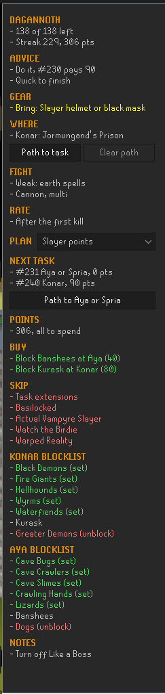
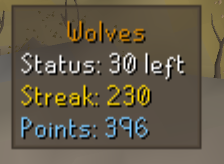
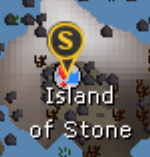

# Slayer Sensei

A RuneLite plugin for Slayer. It reads your task from the game and shows where to go, what gear you are
missing and short notes for the fight. A points plan says which master to use next, which tasks to block
and what to buy with your Slayer points. The plan follows the goal you pick, which is XP, profit or Slayer
points.

It needs no other plugin. [Shortest Path](https://runelite.net/plugin-hub/show/shortest-path) is optional.
When it is installed, Slayer Sensei can ask it to draw the route to your task or to your next master.

<p>
  
  
</p>

## What it shows

The sidebar opens from this icon in RuneLite's toolbar: 

It has two layouts. Compact shows short items under headings, and each item's tooltip gives the reason.
Detailed shows every line as a sentence.

### Task

The sidebar shows the task, the kills left out of the amount assigned, your streak and your points.
Krystilia and Mortimer keep their own streaks, and the sidebar names the one your task counts toward. Once
the kill count starts to go down, a rate line shows kills per hour and roughly how long the task has left.

### Where to go

Konar assigns an area with every task, and only kills there count. The sidebar shows that area. She only
assigns areas you can enter, so her area is never shown as locked.

Other masters leave the place to you. The sidebar lists the places where the task can be done, the
recommended one first, and remembers the place you pick for that task. Krystilia's tasks only count in the
Wilderness, so her list holds only the Wilderness places her wiki page names.

Some places need a quest or a level first, such as Priest in Peril for Morytania or 60 Sailing to land on
Charred Island. The plugin reads those quests and your levels from the game and recommends the first place
in the list you can enter. A place you cannot enter stays in the list and says in red what it needs, and a
place you picked yourself stays picked. When you can enter none of them, the list keeps its order and the
first place says what it needs. A few places carry a note instead, for a gate the plugin cannot check, such
as a level you can boost.

For the chosen place the sidebar says whether it is multicombat and whether a cannon is allowed, when the
wiki says so.

### World map marker

A pin marks the place on the world map. When the place is off screen, the pin becomes an arrow at the edge
of the map that points toward it. Clicking it moves the map there.

<p>
  
  
</p>

### Gear check

The plugin compares what you wear and carry with what the task needs. Items you must have are listed in
red when they are missing, such as a nose peg or Slayer helmet for aberrant spectres, or a mirror shield
for basilisks. For items used up on each kill, such as ice coolers for desert lizards, it compares the
number you carry with the kills left. A diary reward that removes a need is taken into account, such as the
elite Kourend & Kebos diary for the hot floor of the Karuulm Slayer Dungeon. A Slayer reward that finishes a
monster for you, such as Gargoyle Smasher, still needs the item in your inventory, and the check says so.

Items the wiki recommends, such as a demonbane weapon against demons, are listed in yellow. This second
group can be turned off.

Each time you open your bank, the plugin notes which of these items it holds and how many. An item you must
have that is only in your bank is listed in yellow instead of red, such as "In bank: Rock hammer", and a
recommended item in your bank is named, such as "Bring from bank: Arclight". For items used up on each
kill, what you carry counts first, and when your bank has the rest the check says how many more to take.
The check only says you are ready when you wear or carry everything you must have. Until you open your bank
once on a character, only your inventory and worn items are checked, and the tooltip on the GEAR heading
asks you to open it.

The place the task goes to counts as well, whether Konar assigned it or you picked it for another master.
Brimhaven Dungeon asks for an axe for the vines, any axe but the blessed one, and 875 coins for Saniboch,
who takes them each time you go in. Once you have paid him 1,000,000 for permanent access the coins are no
longer asked for. Other places ask for what gets you in, such as a spade for the Barrows crypts, a dramen
or lunar staff for Zanaris until the elite Lumbridge & Draynor diary, a rope for the Kalphite Lair until
the hard Desert diary, or 100 warrior guild tokens for the cyclopes. A rope needed only the first time, at
the Lumbridge Swamp Caves and the God Wars Dungeon, is a note in the tooltip until it is tied. Meiyerditch
Laboratories add a pickaxe to the items to bring, for the quick way in through the mines.

### Fight notes

Short notes for the fight. They give the style to kill it with, its weakness, how it attacks, a prayer
line, whether a cannon suits the place and whether a superior can appear.

### Advice on the task in progress

One line says whether to do the task, skip it, block it or buy its extension, for your goal. A second line
gives a verdict from the task's XP, profit and speed ratings.

### Points plan

The goal sits at the top of the plan, and you can switch it there or in the settings.

- For Slayer points the plan follows the points routine from the wiki. Ordinary tasks go to Turael or Aya,
  or to Spria, who pay nothing but keep the streak going. Every 10th or every 50th task, as you choose,
  goes to the master who pays most for it. The plan names the master for your next task.
- For XP and for profit the plan names the best master you can use, with the reason and the runner-up.
- It lists what to buy with your points now, what to save for, what unlocks once you have the level, and
  purchases that would work against your goal.
- It shows the block list of the plan's master with the blocks to keep, to add and to lift. On the points
  routine the block list at Turael's spot is shown too.
- Stop the Wyvern blocks fossil wyverns at every master without using a slot. For XP the plan buys it first
  once your points cover it, and gives the slot fossil wyverns would take to the next task worth a block.

The plan reads your levels, quests, unlocks, purchases and block lists from the game. It reads each
master's task list from the game's own tables. Items from the reward shop's Buy tab count as owned once the
plugin has seen them in your inventory, worn or in your bank.

### Overlay panel

A small panel over the game shows the task, the kills left, Konar's area, missing gear in red, items to
bring in yellow, your streak and your points. It shows for a while after you get a task and for three
minutes after each kill on the task. It can also stay on screen the whole time you have a task.

## Routes with Shortest Path (optional)

Slayer Sensei works without Shortest Path. When Shortest Path is installed and turned on, the sidebar
gets route buttons.

- **Path to task** draws the route to the place shown under Where.
- A second button draws the route to the master the plan names for your next task.
- **Clear path** removes a route Slayer Sensei drew. Routes you set yourself are left alone.
- With **Route to task** set to **New task and button**, the route to a new task is drawn once when you get
  the task. A task you already had when you logged in is not routed on its own.

The destination goes to Shortest Path through RuneLite's plugin messages, so neither plugin depends on the
other's code. Shortest Path picks the route with its own settings. A few places cannot be reached in Shortest
Path's map. They are still marked on the world map but are not routed to.

If Shortest Path is installed but off, the sidebar has a button that turns it on. If it is not installed,
the sidebar says that it is optional and where to get it.

## Settings

| Setting | Default | What it does |
| --- | --- | --- |
| Show panel | On | Shows the overlay panel. |
| Panel position | Top right | Where the overlay panel sits. |
| Always show panel | Off | Keeps the panel on screen the whole time you have a task. |
| New-task display (seconds) | 120 | How long the panel shows after you get a new task. |
| Gear lines on panel | On | Adds the gear lines to the panel. Missing items are red. Items in your bank and recommended items are yellow. |
| Recommended gear | On | Also checks for items the wiki recommends. When off, only must-have items are checked. |
| Unlock advisor | On | Shows the advice line for the task in progress. |
| Task map marker | On | Shows the world map marker. |
| Full dossier sidebar | On | Adds the sidebar. |
| Sidebar detail | Compact | Compact or Detailed. |
| Points planner | On | Shows the points plan in the sidebar. |
| Planner master | Konar | The master the plan uses when Pin planner master is on, or when your goal names no master yet. |
| Points to keep for skips | 0 | The plan already keeps points for the skips it expects. This keeps at least this many. |
| Route to task | New task and button | Off, Sidebar button only, or New task and button. Every mode except Off adds the route buttons. |
| Slayer goal | Slayer points | XP, Profit or Slayer points. It can also be switched on the plan in the sidebar. |
| Points boost | Every 10th task | For the Slayer points goal. Which milestone tasks go to the master who pays most. |
| Pin planner master | Off | When on, the plan always uses the Planner master. |

## Rules and privacy

- Advice only. The plugin never clicks, types or moves anything in the game. You do every action yourself.
- The only menu entry is RuneLite's own "Focus on" entry for the world map marker. It moves the map and
  sends nothing to the game.
- It draws its sidebar, the overlay panel and the world map marker. It does not highlight monsters or tiles.
- It sends Shortest Path a route only when you press a route button, when you get a new task in New task
  and button mode, or to move or clear a route it drew itself. It turns Shortest Path on only when you press
  that button.
- It makes no network requests. Everything it knows is bundled with the plugin or read from the game client.
- It saves its settings and the place you picked for each task in your RuneLite settings. The Buy tab
  items it has seen are saved there too, per character, and so is what your bank held of the gear check's
  items the last time you opened it, each item by its id with its count. Coins and warrior guild tokens are
  among those items, for the places that charge them. Nothing else about your bank is saved, and the bank is
  only read while you have it open.
- The fight notes, the prayer line among them, are fixed text for each task from the bundled data. They do
  not change during a fight.

## How it differs from other Slayer plugins

The Plugin Hub has many Slayer plugins, and several already do parts of what this one does. These are the
closest ones.

- **Task lookups.** Slayer Helper and Slayer Assistant let you search any task by name and read its
  locations, required items, attack styles and masters. Slayer Wiki adds a Wiki option to the Slayer gem,
  helmet and ring that opens your task's wiki page. Slayer Sensei only covers the task you have and has
  no search.
- **Gear and supplies.** Slayer Prep Check, Slayer Codex, Slayer Best in Bank, Slayer Prep Assistant and
  All-In Slayer build gear setups from what you own, bank included, and some of them plan your inventory
  too. Slayer Item Reminders shows short reminders of required and useful items when you get a task or
  leave the bank. The gear check here is smaller. It looks at what you wear and carry and at what your bank
  held when you last opened it, and lists the must-have items and a few recommended ones. For a full setup
  from your bank, use one of those plugins.
- **Places and routes.** All-In Slayer plans the whole trip and sends the destination to Shortest Path.
  Slayer Simplified routes to a favourite place per monster with Shortest Path. SlayerAIO can send the task
  location to Shortest Path as soon as it sees a new task. Wilderness Slayer marks the best place for
  Krystilia's tasks on the world map. Configurable Slayer Task Overlay shows an overlay with your own text
  for each task and a world map icon you can move, and its icons work with Shortest Path. Slayer Sensei
  covers the same ground with Konar's area, a remembered place for other masters, a world map marker and
  Shortest Path routes.
- **Progress and skips.** SlayerAIO shows the kills left with an ETA, flags tasks to skip or block below
  an XP or GP rate you set, and gives bracelet and extension tips per master. Slayer Task Speed tracks kills
  and task units per hour, learns from your finished tasks and estimates the time left. Slayer Sensei
  has a simpler rate line and an advice line for the task in progress.
- **Masters, blocks and points.** Slayer Boosting and Better Slayer remind you which master to use for
  milestone tasks, from rules you set. Slayer Streak tracks your streak and points and warns you before a
  milestone. Better Slayer also helps with Mortimer's task choice. Slayer Simplified has a streak optimizer
  that picks the master. Slayer Task Odds shows each master's chance of giving a task for your account.
  Slayer Block Lists shows every master's block list with its empty and locked slots. Slayer Alternatives
  shows which other monsters count for your task and their Slayer XP.

What Slayer Sensei adds is one plan for your Slayer points, built from a single goal. It says what to
buy in the reward shop and what to save for, which blocks to keep, add or lift, and which master to use
next. It works these out from your account and the game's own task tables. Apart from SlayerAIO's extension
tips, we found no advice on reward shop purchases in the plugins listed here. The same goal drives the
advice on the task in progress.

## Data and credits

The plugin bundles three data files in `src/main/resources`.

| File | What it holds | Where it came from |
| --- | --- | --- |
| `slayer_tasks.json` and `slayer_tasks_supplement.json` | Notes for each task on where to go, how to fight it, the items it needs and notable drops. Rough XP, profit and speed ratings. A fallback line with each master's weight for the task. | The notes and ratings were written from OSRS Wiki pages, mainly the Slayer task, monster and location pages, the Slayer training guide and money making guides. The weights come from the game cache's Slayer tables. When the plugin can read those tables in the client, it shows their values. |
| `slayer_areas.json` | Places where tasks can be done, with world map points, kill spots for Shortest Path, cannon and multicombat facts, what each place needs to get in, and the list of places for each task. | Built by `tools/wiki-extract` from OSRS Wiki pages (task location tables, monster spawn tables and location pages), from RuneLite's world map data (dungeon, transport and fairy ring locations in RuneLite 1.13.1) and from the game cache (the ids and names of the areas Konar assigns, read with `tools/cache-dump`). Every point and fact names its source. What each place needs comes from the wiki's location, region and Slayer task pages, each with the sentence or infobox field it was read from (`tools/wiki-extract/access.json`). |

Kill spots were also checked against Shortest Path's collision map so that a route can reach them. No
Shortest Path data is bundled.

While it runs, the plugin also reads the game's own Slayer tables from the client, such as reward costs and
each master's task list. Those are not bundled.

The tests use a trimmed copy of the game's Slayer tables, made by `tools/cache-dump`, and a table from the
wiki's Slayer training page. Both are in `src/test/resources` and are not part of the plugin jar.

**OSRS Wiki.** The footer of the [Old School RuneScape Wiki](https://oldschool.runescape.wiki) says its
content is licensed under [CC BY-NC-SA 3.0](https://creativecommons.org/licenses/by-nc-sa/3.0/) and that
additional terms apply. It links to Weird Gloop's [Licensing](https://meta.weirdgloop.org/w/Licensing) page,
and the wiki's copyright page points to the same page. That page says Old School RuneScape Wiki revisions
from 1 October 2018 on are under CC BY-NC-SA 3.0 and earlier revisions under CC BY-SA 3.0. It also says
that anyone who reuses the content must credit its authors, for example with a link to the pages used. The
source fields in `slayer_areas.json` name where each point and fact came from, and most wiki sources there
include a link to the page.

**RuneLite.** Most entrance points come from the world map data in the RuneLite client, which is under the
BSD 2-Clause license. The rest come from the wiki's maps and spawn lists.

**Shortest Path.** Routes are drawn by the [Shortest Path](https://github.com/Skretzo/shortest-path) plugin
by Skretzo and contributors, when you have it installed.

These credits also ship inside the plugin, in `META-INF/NOTICE.txt`.

Slayer Sensei is a fan-made plugin. It is not affiliated with Jagex or with the RuneLite developers.

## Building

Needs Java 11.

```
./gradlew run     # starts RuneLite with the plugin loaded
./gradlew test
```

To log in with a Jagex account in the development client, follow RuneLite's guide
[Using Jagex Accounts](https://github.com/runelite/runelite/wiki/Using-Jagex-Accounts).

The `tools` folder holds the programs that build and check the bundled data. They are not part of the plugin
build. See [tools/wiki-extract](tools/wiki-extract/README.md) and [tools/cache-dump](tools/cache-dump/README.md).

## License

The plugin code is under the BSD 2-Clause license in [LICENSE](LICENSE). The bundled data and its sources
are described under Data and credits.
